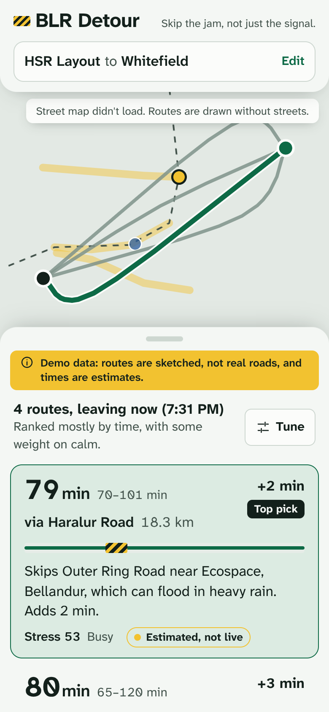

# BLR Detour

**Skip the jam, not just the signal.** A one-screen web app that recommends routes across Bengaluru that avoid chokepoints like Silk Board, Hebbal and Marathahalli bridge, even when they are a few minutes longer on paper. Every route gets a plain reason, a time range, a stress score, and an honest label for how sure we are.



## Run it

```bash
npm install
npm run dev            # http://localhost:3000, demo mode, no keys needed
```

Demo mode is automatic when no provider keys are set. A yellow banner says routes are sketched and times are estimates. Every card reads "Estimated, not live".

## Live mode (real traffic)

Add **one** environment variable: `TOMTOM_API_KEY` (free at developer.tomtom.com, no card). Routes, live traffic, real road shapes, turn-by-turn steps, and address search then come from TomTom, the demo banner disappears, and cards say "Live". `/api/health` should show `"mode":"live"`. Details and limits are in `docs/providers.md`.

To check live mode without a key: `node tests/fake-tomtom/server.mjs`, then `TOMTOM_API_KEY=test-key TOMTOM_BASE_URL=http://localhost:4010 npm run dev`.

## Scripts

| Script                            | What it does                                                                                                                                                  |
| --------------------------------- | ------------------------------------------------------------------------------------------------------------------------------------------------------------- |
| `npm run dev` / `build` / `start` | Next.js. `predev`/`prebuild` copy the MapLibre worker to `public/maplibre/`.                                                                                  |
| `npm test`                        | Vitest unit tests (engine, providers, copy).                                                                                                                  |
| `npm run test:e2e`                | Playwright main flow, mobile and desktop. Run `npx playwright install chromium` first, or set `CHROMIUM_PATH` (and optionally `CHROMIUM_ARGS`, a JSON array). |
| `npm run lint` / `format`         | ESLint (Next + Prettier) / Prettier.                                                                                                                          |
| `npm run design:detect`           | Impeccable's anti-pattern detector on `app components lib`.                                                                                                   |

A Husky pre-commit hook runs lint-staged (ESLint and Prettier on staged files) and `npm test`.

## Environment

See `.env.example`. `ROUTE_PROVIDER` (`google|osrm|mock`), `TRAFFIC_PROVIDER` (`google|tomtom|historical|mock`), `GOOGLE_MAPS_API_KEY`, `TOMTOM_API_KEY`, `OSRM_URL`, `DATABASE_URL`, `NEXT_PUBLIC_MAP_STYLE_URL`. `/api/health` shows which providers are active and whether each key is set, never the values.

## How it works

- `lib/engine/`: pure scoring. `score = w_time·time + w_calm·stress_min + w_pred·spread_min + w_risk·risk_min`, with every constant commented in `config.ts`. Reasons explain the score.
- `lib/providers/`: `RouteProvider` and `TrafficProvider` interfaces. Mock (deterministic, through named Bengaluru roads) and Historical (hourly speed per road class plus chokepoint peak delay). Google, TomTom and OSRM are Phase 4 placeholders.
- `data/bengaluru/`: `zones.json` (11 chokepoints), `construction.json`, `monsoon_flood.json` (June to October), `profiles.json` (peak windows, weekend and holiday profile, speeds), `places.json` (demo gazetteer). All **seed data, not field-checked**, and labelled that way in the UI.
- `app/api/`: `/api/routes` (Zod-validated, cached per ~110 m and 5 minutes, rate-limited, daily cap), `/api/geocode`, `/api/health`.
- `components/`: search combobox, route cards with the jam strip, settings sliders, bottom sheet (mobile) or side panel (desktop), MapLibre map with an SVG sketch fallback.
- `messages/en.ts`: every UI string, ready for `kn.ts`.

## Acceptance criteria

| Criterion                                                 | Result                                                       | Evidence                                                                                  |
| --------------------------------------------------------- | ------------------------------------------------------------ | ----------------------------------------------------------------------------------------- |
| 3–4 distinct route cards within 3 s                       | **Pass** (demo)                                              | E2E asserts count and timing. Skeletons show immediately.                                 |
| Each card: time, range, delta, stress, reason, confidence | **Pass**                                                     | E2E checks every card, plus the screen-reader label.                                      |
| Weight change re-ranks without reload                     | **Pass**                                                     | E2E: order changes, window marker survives.                                               |
| Selecting a card highlights its path                      | **Pass**                                                     | E2E: `data-selected-route` on the map; screenshots.                                       |
| Runs fully with no keys, with a visible banner            | **Pass**                                                     | E2E plus `/api/health`.                                                                   |
| Stale or historical data never shown as live              | **Pass**                                                     | Unit tests on `confidenceFor`; E2E checks "Estimated, not live".                          |
| Engine unit tests                                         | **Pass**                                                     | 35 Vitest tests.                                                                          |
| Playwright main-flow E2E                                  | **Pass**                                                     | 11 passed, 1 skipped (keyboard test runs on desktop only).                                |
| `impeccable detect` clean or documented                   | **Pass**                                                     | 0 findings in source and on the live page at 390 and 1440 px; 1 documented config ignore. |
| Lighthouse mobile ≥ 90 for Performance and Accessibility  | **Accessibility pass (100). Performance not met here (67).** | See note below.                                                                           |
| Keyboard-only flow                                        | **Pass**                                                     | E2E: Tab, combobox arrows and Enter, card arrow keys, slider arrows.                      |
| `prefers-reduced-motion` disables motion                  | **Pass**                                                     | E2E checks sheet transition is 0 s. CSS drops transforms; JS skips FLIP and map tweens.   |
| No secrets committed; `.env.example` complete             | **Pass**                                                     | No keys in the repo; all variables listed.                                                |

**Lighthouse note.** Measured in a sandbox with headless software-rendered Chromium: FCP 0.8 s, LCP 2.7 s, CLS 0, TBT 2.3–2.7 s. Initial JS is about 124 KB (React and Next, with MapLibre deferred until routes exist). About 2 s of the blocking time is "unattributable" main-thread work, which points at the sandbox rather than page script, but I could not prove that with a clean baseline. **Run PageSpeed Insights on the deployed URL before calling this pass or fail.**

## Docs

`docs/decisions.md` · `docs/skills-used.md` · `docs/providers.md` · `docs/deploy.md` · `PRODUCT.md` · `DESIGN.md`
